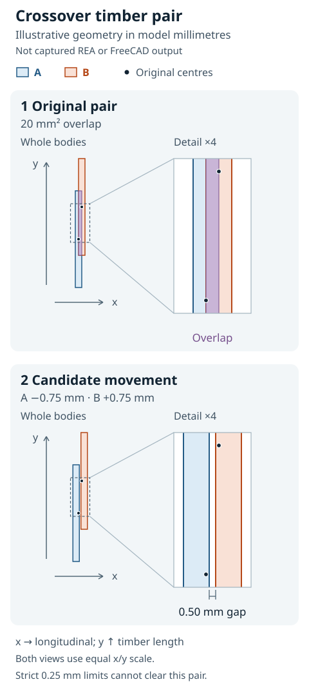

<!-- SPDX-License-Identifier: GPL-3.0-or-later
Copyright (C) 2026 Richard-Gnitnub and TrackTemplateMacro contributors.
Adapted for the TrackTemplate developer handbook, 2026-11-21.
-->

# From crossover timber conflicts to a reversible arrangement

A crossover brings two turnout support layouts and a connecting road into
the space between neighbouring tracks. Correct rail geometry does not by
itself produce a usable timber arrangement: inherited supports can overlap,
compete for the same longitudinal position or leave the connector without
the required support. TrackTemplate first describes those conditions, then
offers shared long timbers and bounded movement of the remaining inherited
timbers. Its automatic resolver combines those stages.
[Analysis assumptions][analysis-defaults]; [resolution assumptions][resolution-defaults]

Four kinds of state matter throughout this workflow:

| State | What it represents |
| --- | --- |
| Source records | The mapped support positions and protected features inherited from each turnout. |
| Analysis | Findings calculated from the currently effective records and the chosen tolerances. Markers display those findings. |
| Applied preview | Saved replacement records and a FreeCAD display object for a shared, adjusted or automatic arrangement. |
| Host integration | A separate operation that replaces the relevant host support geometry using the qualified arrangement. |

An applied timber preview therefore changes the crossover's proposed
support arrangement without replacing the host sleepers or turnout rails.
Hiding it changes presentation; removing it changes which records are
effective. [Preview application][b4-apply]; [preview removal][b4-clear]

**Source revision:** [TrackTemplate
`7965bfc4671668f889c1f43fb8336c5146c3f5cf`][revision]. The retained B15
macro supplies the timber algorithms and panel handlers. B16 installs
additional B4 recovery, persistence and visibility behaviour through
`CrossoverB4RecoveryAdapter`. This chapter follows those final bindings at
the pinned revision, not runtime admission on a later checkout. Read
[Crossover geometry and preflight](crossover-geometry.md) first. The
upstream names **B2A2**, **B3** and **B4** below identify the shared-envelope,
controlled-movement and automatic-resolution stages; they are not three
independent railway designs. [Final adapter binding][adapter-binding]

## Find the controls and their prerequisites

Open **REA C10 turnout and crossover manager...**, select **Crossovers**
and select a managed crossover. The guided timber step offers
**Resolve timbering automatically**, changing to **Rebuild automatic
timbering** when the current B4 result is clear. Its secondary action is
**Analyse timbering** or **Show timber result**. These actions delegate
to the same panel handlers as the specialist controls.
[Guided delegates][guided-delegates]; [final guided state][guided-final]

Select **Show specialist and maintenance controls** to expose the detailed
timber controls. The checkbox initially hides these groups. The following
labels are the actual panel controls, including their distinction between
analysis, a calculated arrangement and display visibility.
[Widget creation][widgets]; [signal bindings][bindings]

For example, these exact signal connections distinguish running the
analysis from changing its display:

```python
self.analyse_timber_button.clicked.connect(self.analyse_selected_timbering)
self.show_conflict_markers_checkbox.toggled.connect(self.set_conflict_marker_visibility)
self.show_support_markers_checkbox.toggled.connect(self.set_support_marker_visibility)
```

`analyse_selected_timbering` calls `analyse_rea_c10_crossover_timbering`.
The shared, B3 and B4 panel handlers call their respective
`apply_crossover_shared_long_timbers`, `apply_crossover_b3_timbering` and
`apply_crossover_b4_timbering` operations; the last name resolves to B16's
adapter at this revision. [Handlers][controls]; [final B4 binding][adapter-binding]

| Analysis control | Behaviour |
| --- | --- |
| **Analyse selected crossover timbering** | Analyse effective records, or reuse a matching result. |
| **Analysis tolerances…** | Set model-scale calculation tolerances and cache reuse for the next analysis. |
| **Show conflict markers**; **Show protected support markers** | Change the corresponding diagnostic visibility. |
| **Show timber analysis details**; **Copy readable analysis summary** | Read or copy the stored findings, with a warning when stale. |
| **Clear temporary analysis display** | Remove owned diagnostic objects while retaining cached analysis metadata. |

| Arrangement stage | Build or resolve | Details and settings | Display and removal |
| --- | --- | --- | --- |
| Shared envelope | **Build shared long-timber envelope** | **Show shared-envelope details**; **Shared-envelope settings…** | **Show shared long-timber result**; **Remove shared long-timber envelope** |
| B3 adjustment | **Resolve remaining timber conflicts** | **Show interlacing and movement details**; **Interlacing and movement settings…** | **Show adjusted timbering**; **Remove interlacing and timber movement** |
| Automatic B4 | **Resolve crossover timbering automatically** | **Show automatic resolution details** | **Show final resolved timbering**; **Remove automatic timbering result** |

Analysis requires a selected crossover. Shared-envelope and B4 application
also require that host integration is inactive. B3 application additionally
requires an existing, current shared result. Arrangement removal and
visibility controls require their corresponding stored result and are
disabled while integrated; their details remain available. Analysis and
its diagnostic display controls remain enabled for a selected crossover.
Remove integration before changing the arrangement.
There is no separate B4 settings dialogue: automatic application uses the
current shared-envelope and B3 settings, plus its display choice.
[Enablement][enablement]; [handlers and dialogues][controls]

## Extract source supports in a common frame

`crossover_inherited_timber_records` reads both host centrelines and the
two constituent turnout configurations. It regenerates the source support
layouts and maps each support through its own host, toe chainage,
facing/trailing orientation and handing. Missing host or constituent data
prevents this extraction. [Inherited records][inherited-records]

The following exact excerpt from `_timber_record_from_layout` constructs
the planar collision body from the mapped outline:

```python
local_outline = _turnout_timber_outline_local_points(timber)
mapped_outline = _turnout_map_polyline(
    host_data, toe_chainage, orientation, handing, local_outline
)
outline = [_timber_xy(point) for point in mapped_outline]
if outline and _timber_distance(outline[0], outline[-1]) <= 1.0e-8:
    outline.pop()
collision_polygon = _timber_convex_hull(outline)
```

These are numeric XY polygons, with a convex hull for collision checking.
They are not FreeCAD solid-intersection results. Each record also carries
its stable identity, parent turnout, source identifier, centre, axes,
length, width, end and side segments, source configuration and protected
features. A typical identity combines crossover, side and source support
identifier, so a display object name is not the support's identity.
[Record construction][record-construction]

The two station fields answer different questions:

| Field | Reference and meaning |
| --- | --- |
| `host_chainage` | Station along that support's own host: toe chainage plus the orientation-signed local longitudinal coordinate. |
| `longitudinal_station` | Projection of the mapped centre into a common frame whose origin is Host A's turnout toe and whose positive axis follows Host A's configured turnout travel direction. |

The common projection lets the analyser compare A and B support positions.
It must not be treated as distance travelled along Host B's curved
centreline. [Record coordinates][record-construction]; [reference frame][inherited-records]

Source identifiers and sections assign protected-feature labels such as
`switch toe`, `switch heel`, `common-crossing A timber` and
`vee-nose support`. All inherited records have a protected support region;
that flag alone does not forbid movement. B3 applies a stricter movement
allowance to a defined subset of features and checks that the original
support centre remains inside the moved body.
[Feature classification][protected-features]; [B3 protection][b3-protection]

## Analyse the effective arrangement

`analyse_rea_c10_crossover_timbering` asks `crossover_timber_records` for
the records currently in force. It prefers a current applied B4 result,
then a valid B3 result over the current shared arrangement, then that
shared arrangement, and finally the inherited records. Each derived stage
must match its dependencies and stored signatures. A stale saved result
does not automatically remain authoritative because its object is visible.
[Effective-record selection][effective-records]; [analysis operation][analysis-operation]

### Model tolerances describe comparisons, not prototype positions

The source explicitly calls the analysis tolerances configurable
model-scale manufacturing assumptions. They do not move the source
prototype support positions. The normaliser rejects unusable numeric
values by falling back to defaults, clamps finite values to supported
ranges, and keeps near-touching and minimum-clear-spacing tolerances at
least as large as the intersection tolerance.
[Defaults and meaning][analysis-defaults]; [normalisation][analysis-settings]

| Analysis setting | Default | Interpretation |
| --- | --- | --- |
| Intersection tolerance | 0.05 mm | Squared to form the usual body-overlap area threshold, 0.0025 mm². |
| Near-touching tolerance | 0.30 mm | Used when classifying the distance between timber ends. |
| Minimum clear spacing | 0.50 mm | Required clearance in the relevant end/side comparisons. |
| Same longitudinal-position tolerance | 0.50 mm | Difference between projected longitudinal stations. |
| Maximum advisory skew | 3° | Advisory comparison against the relevant ordinary support orientation. |

After spatial filtering identifies possible neighbours,
`analyse_crossover_timber_records` intersects their convex polygons.
This exact excerpt shows why a
0.05 mm setting must not be described as a 0.05 mm² overlap limit:

```python
intersection = _timber_convex_intersection(polygon_a, polygon_b)
overlap_area = abs(_timber_polygon_area(intersection))
area_a = first_geometry["area"]
area_b = second_geometry["area"]
same_parent = first["turnout_side"] == second["turnout_side"]
pair_label = "internal {}".format(first["turnout_side"]) if same_parent else "between turnout A and turnout B"
if overlap_area > max(1.0e-6, intersection_tolerance * intersection_tolerance):
```

The body-intersection finding can coexist with other findings. Covering at
least 98% of the smaller body adds a coverage finding. An overlap between
A and B with a shared non-generic protected feature can also identify
competing support. Generic closure-rail, stock-rail and future-chair labels
do not by themselves establish that duplicate-special-support condition.
Further checks inspect end and side clearances, projected station and skew.
[Polygon analysis][analysis-pairs]; [generic exclusions][generic-features]

Results distinguish **Informational**, **Advisory**, **Production conflict**
and **Production-critical conflict**. The analyser always retains a
`rail_and_flangeway_clearance_deferred` finding and reports
`rail_clearance_checks_reliable` as false. A result without production
conflicts therefore does not establish chair fit or manufacturing readiness.
[Result and deferred checks][analysis-result]

### Store findings separately from their markers

Analysis does not change production timber, rail or host geometry. It can
write document metadata and create or replace diagnostic objects. The
settings object stores `CrossoverTimberAnalysisStatus`,
`CrossoverTimberAnalysisSignature`, `CrossoverTimberAnalysisSettingsJSON`
and `CrossoverTimberAnalysisResultJSON`.
[Metadata writer][analysis-metadata]

A matching calculation signature allows reuse. If the expected marker
objects also exist, the operation updates their visibility and returns
without a new transaction or metadata write. Otherwise it opens a
transaction, replaces the owned analysis objects, stores the result and
recomputes. **Clear temporary analysis display** removes only the selected
crossover's analysis group and marker roles, with children removed before
their group; it leaves the cached findings available.
[Analysis/cache operation][analysis-operation]; [owned display cleanup][analysis-cleanup]

`crossover_timber_analysis_effective_status` recalculates the input
signature without writing to the document. A mismatch or unusable current
inputs returns **Analysis stale**. Both the detail view and copied summary
warn the reader to rerun the analyser before using stale findings.
[Effective status][analysis-status]; [details and copy][analysis-details]

## Build shared supports before moving inherited timbers

The shared-envelope stage first tests whether compatible inherited A/B
positions can use one enclosing long timber. It compares their common
longitudinal stations and undirected timber axes, then derives an enclosing
rectangle. The candidate must retain both source centres and every vertex
of their support-zone polygons. It must also avoid unacceptable
intersections with unaffected supports.
[Pair candidate][shared-pair]; [neighbour collision gate][shared-collision]

| Shared-envelope setting | Default and role |
| --- | --- |
| Maximum inherited station offset | 1.00 mm for the pair test. |
| Maximum inherited angle difference | 2° for the pair test. |
| Maximum width expansion | 0.35 mm beyond the wider source member. |
| End allowance / maximum shared length | 0.00 mm / 0, where zero length limit means no configured cap. |
| Collision tolerance | 0.05 mm² at the point of use: this stage compares the setting directly with intersection area. |
| Connector spacing | At most 30 prototype inches between fitted positions. |
| Envelope clear separation / allowance | 0.50 mm / 1.00 mm. |
| Return confirmation | Three consecutive clear positions. |
| Maximum shared-envelope skew | 12° against each supported route's normal. |

These defaults come from the shared settings, not the analysis dialogue.
In particular, the inherited assumption text describes the collision
setting with inconsistent units; its actual comparison is against area.
Do not transfer the analysis routine's squared threshold to this gate.
[Shared defaults and normalisation][shared-settings]; [area comparison][shared-collision]

The width decision in `_shared_timber_candidate` is explicit:

```python
required_width = maximum_width - minimum_width
standard_width = max(float(first.get("width") or 0.0), float(second.get("width") or 0.0))
allowed_width = standard_width + float(settings["maximum_width_expansion"])
if required_width > allowed_width + 1.0e-7:
    return None, "required width {:.3f} mm exceeds allowed {:.3f} mm".format(required_width, allowed_width)
width = max(standard_width, required_width)
```

This gate prevents the pair helper from accepting an arbitrarily wide
rectangle merely because it encloses both original bodies. Length rounds
up in six-prototype-inch increments; the helper's default 1:76.2 scale
makes each increment 2 mm. It checks any configured maximum length after
deriving the required support envelope. [Pair dimensions and containment][shared-pair]

The complete B2A2 proposal does more than pair replacement. It extends
suitable inherited supports towards the other host, fits connector
positions, and uses connector and host footprints to determine which
positions need a shared envelope. The common timber axis follows the
supported routes and must satisfy the skew limit for every route. Three
clear positions confirm a return to nominal single-road connector supports;
where the necessary look-ahead is absent, the envelope can continue towards
the end. Rejected positions retain their reasons. The stage analyses the
whole resulting arrangement and rejects an increased critical-finding count.
[Envelope construction][shared-envelope]; [complete proposal][shared-proposal]

Building this result stores replacement records and a preview. It does
not yet replace the host support geometry. The source prototype references
remain distinct from the model allowances that produced the replacement
envelope. If the proposal generates no timbers, the operation returns
before opening its own application transaction; the chair-display cleanup
qualification below still applies. [Shared application][shared-apply]

## Resolve remaining conflicts within movement limits

B3 works on the current shared arrangement. Only remaining inherited A/B
records qualify for movement: shared long timbers and nominal connector
supports stay fixed. B3 moves a timber longitudinally along its local rail
heading; it does not shorten, omit, rotate, widen or invent one.
[Eligibility and movement][b3-protection]; [declared bounds][b3-defaults]

| B3 setting | Default and meaning |
| --- | --- |
| Maximum timber movement | 1.50 mm per record, accounting for accumulated movement. |
| Movement increment | 0.25 mm in the search. For symmetric movement this increments total pair separation, so a half-movement can be 0.125 mm. |
| Minimum clear spacing | 0.50 mm. |
| Maximum interlacing separation | 3.00 mm of additional total pair movement, not a maximum final centre spacing. |
| Maximum angle difference | 6° for the controlled-movement pair. |
| Protected support movement allowance | 0.25 mm for the strict feature subset, also bounded by the ordinary maximum. |
| Collision tolerance | 0.05 mm² at the area comparison. |
| Resolve advisory same position | False by default. |

The strict subset includes switch toe, first slide-chair position, switch
heel, common-crossing A/B timbers, vee/crossing-nose support and the
specified rail-joint support labels. These are the source's inherited
classifications. Regardless of the applicable movement allowance, the
original support centre must remain inside the moved body.
`_b3_support_preserved` checks both conditions:

```python
movement = abs(float(record.get("b3_total_movement_mm") or 0.0))
limit = _b3_protected_limit(record, settings)
if movement > limit + 1.0e-9:
    return False, "movement {:.3f} mm exceeds the {:.3f} mm support limit".format(movement, limit)
support = tuple(record.get("b3_original_support_centre") or record.get("centre") or (0.0, 0.0))
polygon = [tuple(point) for point in record.get("collision_polygon") or []]
if len(polygon) < 3 or not _timber_point_in_convex_polygon(support, polygon, 1.0e-7):
    return False, "the original protected support centre would no longer lie inside the moved timber"
```

This preserves the original centre, not the entire original support polygon.
That distinction matters: shared-pair enclosure checks all source-zone
vertices, whereas this movement rule permits bounded displacement around
the retained centre. [Strict features and defaults][b3-defaults];
[support check][b3-protection]

For each target, B3 first accepts an already safe stagger with no movement.
It then tries increasing pair separations in both directions, sharing the
movement equally where possible and respecting each member's allowance.
Only if no pair trial succeeds does it try single-timber longitudinal
movements. This ordered search does not establish a global minimum across
both strategies. Each candidate must meet the pair's area, polygon-gap
and projected-centre-spacing conditions, preserve support, introduce no
new production-conflict keys, and avoid increasing the critical count.
[Pair geometry][b3-pair]; [whole-arrangement acceptance][b3-acceptance];
[search and unresolved results][b3-search]

## Work through one conflicting pair

This is **independent illustrative arithmetic**, not a recorded XO-001
arrangement or an executed FreeCAD resolver. All dimensions are model
millimetres. The deliberately simple 2 mm width is not the source's REA
default timber width. Let x follow both local rail headings and y follow
the timber length. Assume no neighbouring supports, no previous movement
and two remaining inherited A/B records with valid source zones equal to
the rectangles below. Give them only the non-strict generic labels
`closure-rail support`, `stock-rail support` and `future special-chair datum`.

| Input | A | B |
| --- | --- | --- |
| Centre (x, y) | (0, 0) | (1, 10) |
| x bounds | −1 to 1 | 0 to 2 |
| y bounds | −15 to 15 | −5 to 25 |
| Width × length | 2 × 30 mm | 2 × 30 mm |
| Timber angle | 90° | 90° |
| Projected longitudinal station | 0 mm | 1 mm |



### Detect the overlap and test a shared pair

The overlapping x interval is 0 to 1; the overlapping y interval is −5 to
15. Their intersection area is therefore **1 × 20 = 20 mm²**, above the
analysis threshold of **0.05² = 0.0025 mm²**. It occupies one third of
each 60 mm² body, below the 98% full-coverage condition. The declared
generic features do not add a duplicate-special-support finding.
[Analysis gates][analysis-pairs]; [feature exclusions][generic-features]

The inherited shared-pair test accepts the **1.00 mm** station offset and
**0°** angle difference. However, the enclosing x interval is −1 to 2:
it needs **3.00 mm** width, above **2.00 + 0.35 = 2.35 mm**. That helper
rejects the candidate at its width gate. This does not establish the
outcome of a full B2A2 pass, which also needs host and connector context.
[Shared-pair gate][shared-pair]

For a comparison, change only B's x centre to **0.25 mm**. The enclosing
width becomes **2.25 mm**, within 2.35 mm, and the required length remains
**40 mm**, already a multiple of the default 2 mm increment. The resulting
centre is **(0.125, 5)**. That candidate passes these pair dimensions and
contains both source zones; neighbour and whole-arrangement checks still
apply. A smaller station offset can therefore permit sharing without
relaxing the configured width allowance.

### Try controlled separation

Return to B's original centre at x = 1. For the declared equal-width,
parallel pair, B3 requires centre spacing

**(2 + 2) / 2 + 0.50 = 2.50 mm.**

The current spacing is 1.00 mm, so the additional separation must be
**1.50 mm**. In the outward symmetric search, moving A by **−0.75 mm**
and B by **+0.75 mm** is the first trial on the 0.25 mm total-separation
grid that meets this requirement. [Pair conditions][b3-pair]; [search order][b3-search]

| Calculated value | Candidate |
| --- | --- |
| Final centres | A (−0.75, 0); B (1.75, 10). |
| Final x intervals | A [−1.75, 0.25]; B [0.75, 2.75]. |
| Body gap / overlap | 0.50 mm / 0 mm². |
| Final projected centre spacing | 2.50 mm. |
| Original-centre containment | A's x = 0 and B's x = 1 remain inside their respective moved bodies. |

Each 0.75 mm movement is below the 1.50 mm ordinary allowance. The pair
meets the illustrated geometry and centre-preservation conditions. A
single 1.50 mm shove would instead move the original centre outside its
2 mm-wide body. The successful symmetric arithmetic still needs the
resolver's whole-arrangement acceptance check; it is not a recorded
application result. [Support check][b3-protection]; [acceptance gate][b3-acceptance]

### Keep a protected failure explicit

Add the strict source label `switch toe` to both original records. Their
combined permitted outward movement is now only **0.25 + 0.25 = 0.50 mm**.
That increases centre spacing to **1.50 mm**, short of the required
2.50 mm. A permitted single shove is also insufficient. If these records
reach B3 under the declared limits, the pair remains unresolved; the
resolver must retain the reason rather than increase the allowance.
This variant can also add a protected-support finding in the initial
analysis. It does not establish a whole-result unresolved count.
[Strict allowance][b3-protection]; [failure retention][b3-search]

The committed
{download}`figure tool <../../tools/render_crossover_timber_figure.py>`
checks this rectangle arithmetic without importing the workbench or running
its solver. From the documentation repository, this command checks the
values and the saved figure without changing files:

```bash
python tools/render_crossover_timber_figure.py --check-only
```

## Let B4 coordinate the complete calculation

`resolve_crossover_b4_timbering` starts from inherited records, analyses
them, builds the full shared envelope and passes that arrangement to B3.
It does not depend on the user having manually created each intermediate
preview. The internal shared result is marked `applied` for the B3
calculation; that numeric flag alone does not prove a document transaction
has occurred. [Automatic resolver][b4-solver]

B4 takes B3's final unfiltered analysis when available, otherwise
recalculates it. Remaining production or critical findings take precedence
over a merely partial result; unresolved positions also prevent completion.
The resolver rejects an increase in the **number** of critical findings
relative to inherited analysis. That count comparison alone is not proof
that every finding identity remained unchanged.
[Final analysis and rejection][b4-solver]

The exact completion expression is:

```python
"timber_resolution_complete": not unresolved and production_conflicts == 0 and critical_conflicts == 0,
```

The returned preview also carries `resolved_timbers`, the child shared/B3
results, unresolved identities and reasons, counts, settings and signatures.
Its `production_ready` and `host_integration_allowed` flags are initially
false. On application, the configuration writer separately derives
integration eligibility from complete, conflict-free timbering; the final
guided workflow additionally requires a validated 2D chair layout. Neither
the completion flag nor the preview object performs host integration.
[Result fields][b4-solver]; [configuration readiness][b4-metadata];
[final guided gate][guided-final]

The resulting status explains the remaining work:

| Exact B4 status | Meaning |
| --- | --- |
| **Automatic timbering resolved — no production conflicts detected** | No unresolved positions and no production/critical findings in the final timber analysis. |
| **Automatic timbering applied — unresolved positions remain** | Explicit unresolved positions remain, without production findings taking precedence. |
| **Automatic timbering applied — production conflicts remain** | Final production or critical findings remain. |
| **Automatic timbering result stale** | The stored result no longer matches its current dependencies. |

These are timber-resolution states, not general output-use acceptance.
[Status constants][b4-defaults]; [currentness][b4-current]

## Keep visibility out of railway state

The analysis signature includes relevant geometry, protected features and
calculation settings. It explicitly removes display and cache choices:

```python
def _timber_geometry_signature(crossover_config, settings, records):
    """Return the stable calculation signature, excluding display-only controls."""
    config = dict(crossover_config or {})
    calculation_settings = normalise_crossover_timber_analysis_settings(settings)
    for key in ("show_conflict_markers", "show_support_markers", "cache_enabled"):
        calculation_settings.pop(key, None)
```

Hiding conflict markers therefore does not change the conditions they
describe. Changing a calculation tolerance does. The signature contains
the calculation's schema and geometry inputs, so reuse must remain tied
to those inputs. [Analysis signature][analysis-signature]

B16's `CrossoverB4RecoveryAdapter.resolution_signature` makes the same
distinction for B4 visibility by normalising the hash input:

```python
"""Keep B16 B4 resolution independent of display visibility."""
settings = self.module.normalise_crossover_b4_settings(settings)
settings["show_b4_geometry"] = True
return self.original_signature(
    config, settings, inherited_signature, shared_result,
    b3_result, records, unresolved,
)
```

The constant is used for the signature; it does not force the preview to
be visible. The adapter can recognise a matching legacy hidden signature
through temporary normalised copies without rewriting stored data.
[B16 signature and legacy recognition][recovery-signature]

For a current, non-integrated B4 result with its tagged object present,
the adapter can reuse the result when only the requested display flag
changes and all calculation/dependency settings still match. It changes
`ViewObject.Visibility` without solving, rebuilding the shape, rewriting
metadata or adding Undo history. The refreshed panel reads actual object
visibility. A missing object, stale geometry or changed B3 setting falls
outside that display-only path. Thus hiding the worked arrangement would
leave its records, gaps and protected-support obligations unchanged.
[Display-only reuse][recovery-display]; [panel synchronisation][adapter-visibility]

## Apply, remove and recover a preview

The application operations combine numeric records, document objects and
stored results. Their names do not mean that host integration has already
occurred. When B4 calculates a new result, application constructs or updates
its preview, hides earlier displays, stores complete B4/analysis metadata
and rebuilds diagnostic markers. Earlier shared/B3 objects can remain
hidden; the automatic calculation does not necessarily create separate
intermediate preview objects. If the stored result, settings and existing
object are current, the inherited application can instead reuse them
without solving or opening an application transaction.
[B4 application][b4-apply]

| Removal command | Effective arrangement and display restored |
| --- | --- |
| **Remove automatic timbering result** | A current preceding B3 result if available; otherwise a current shared result; otherwise inherited references. It reanalyses that arrangement and clears B4 integration eligibility. |
| **Remove interlacing and timber movement** | Remove B4/B3 results, restore any shared object's saved visibility, and analyse effective B2 records. Those records fall back to inherited supports if the shared result is stale. |
| **Remove shared long-timber envelope** | Remove B4/B3/shared results and return to inherited references. |
| **Clear temporary analysis display** | Remove markers only; keep the arrangement and cached findings. |

Restoring visibility does not make stale records current. Automatic
removal selects an earlier result only when it is available and current;
it does not promise that every historical preview object remains present.
These explicit removal operations also differ from FreeCAD Undo,
which depends on document transaction/history behaviour.
[B4 removal][b4-clear]; [B3 removal][b3-clear]; [shared removal][shared-clear]

### Respect the actual transaction boundaries

On the calculation path, B4 application validates inputs, resolves records
and prepares its shape before opening the application transaction. It
clears dependent chair display inside that transaction:

```python
doc.openTransaction("Apply Version {} hybrid timbering {}".format(MACRO_VERSION_NUMBER, identifier))
transaction_open = True
clear_chair_analysis_display(doc, "crossover", identifier)
pipeline_timings["transaction_and_chair_invalidation"] = (time.perf_counter() - stage_start) * 1000.0
```

Shared apply/clear, B3 apply/clear and **B4 clear** instead call chair-display
cleanup before their later integration/existence guards and before their
own transaction. A rejected call can therefore already have removed
dependent diagnostic display. The implementation attempts transaction
abort on failures, but these boundaries do not justify a blanket promise
that every failed command leaves all document state untouched.
[B4 transaction][b4-apply]; [shared operations][shared-apply];
[shared clear][shared-clear]; [B3 operations][b3-apply]; [B3 clear][b3-clear];
[B4 clear][b4-clear]

The final chair cleanup binding removes owned chair markers, unresolved
markers and lightweight 2D chair display. Timber operations do not
universally call a chair-analysis invalidator. Instead, later effective
status checks compare current inputs with the stored signature. Chair
analysis obtains crossover supports through the same effective-record
selector described above.
[Final cleanup binding][chair-cleanup]; [unresolved-marker cleanup][chair-cleanup-2d];
[chair timber input][chair-input];
[chair effective status][chair-status]

B16's final chair signature uses exact neutral rail/timber fields,
including protected features, support requirements and source
configuration, while excluding display/cache choices. Its format
discriminator invalidates older cache keys. The earlier rounded signature
in the retained macro is not the final binding. A changed timber
arrangement therefore needs current dependent chair analysis and layout
evidence, even if an older cached chair result remains stored.
[Final signature binding][chair-binding]; [signature implementation][chair-signature]

### Persist complete analysis and clean up only an owned orphan

The B16 recovery adapter's nested `guarded_writer` supplies complete
effective analysis before the inherited combined metadata writer
serialises the result:

```python
b4_result["resolved_analysis"] = dict(analysis_result)
return original_writer(
    writer_doc, config, b4_result, analysis_result,
)
```

This closes the historical gap between the enriched result returned to the
caller and the nested analysis saved in `CrossoverB4ResultJSON`. The
geometry signature and analysis basis must survive persistence as part
of that analysis. [Guarded writer][recovery-apply]; [persistence assertions][recovery-test-persistence]

The same adapter handles a narrower failure: the first tagging operation
on a newly created B4 feature can fail before the usual role/identity tags
exist. It records that specific failure and checks ownership before
removing any orphan:

```python
orphan = doc.getObject(failed_new_b4_tag)
if orphan is not None:
    if not self._new_object_is_owned(
        doc, orphan, failed_new_b4_tag, identifier,
    ):
        raise CrossoverB4RecoveryError(
            "The failed crossover timbering object cannot be "
            "identified for cleanup."
        ) from error
    try:
        doc.removeObject(failed_new_b4_tag)
```

The predicate requires the command-specific name prefix, `Part::Feature`
type, expected crossover label, absent role/identity tags and continued
document presence. After cleanup, the adapter compares object names,
Undo/Redo counts and crossover configuration with their before-state.
It rethrows the original error after successful bounded recovery, or a
recovery error if ownership, cleanup or comparison fails. This is not a
general mechanism for restoring arbitrary FreeCAD failures.
[Ownership and guarded recovery][recovery-apply]

## Read retained evidence within its limits

The worked rectangles above explain decision gates. The retained curved
XO-001 case instead records a complete arrangement: **86 effective
supports**, comprising **36 A, 34 B and 16 ENVELOPE**, with no moved
timbers, interlaced pairs, unresolved positions or production conflicts.
Its 16 envelope records comprise four inherited A extensions, six B
extensions and six connector/host shared records. It does not demonstrate
a B3 movement or the protected failure in the illustration.
[Historical contract][contract]; [recorded composition][characterisation]

| Evidence | What the source records or defines |
| --- | --- |
| Historical B14/B15 characterisation | Fixed-fixture geometry and the earlier incomplete-analysis persistence, visibility-signature and first-tag orphan defects. These are historical findings, not a description of the successor adapter's intended behaviour. |
| Retained B16 error/persistence evidence | Bounded XO-001 first-tag recovery with UndoMode 0/1; successful subsequent application; Undo/Redo; and a save/close/reopen journey with complete analysis preserved. |
| Retained B16 display evidence | A GUI visibility-only journey that avoided solver/shape reconstruction and metadata/history changes; hidden state survived reopening. A separate calculation-setting change required recalculation. |
| Recovery validation source | Defines adapter, persistence, failure-injection and lifecycle assertions for its specified fixture and host profile. Inspecting it does not execute those assertions. |

The retained display evidence also records a derived group-shape hash
difference after reopening and differences between analysis hashes from
separate headless/GUI runs. Its bounded conclusions must not become a claim
of universal full-payload or shape equality. Consult the owning records
for their exact scope. [Historical defects][characterisation];
[retained recovery/persistence][retained-recovery]; [retained display evidence][retained-display];
[validation source][recovery-test]

For this chapter, the implementation and evidence were inspected at the
pinned revision and the independent rectangle arithmetic was checked.
No FreeCAD operation, workbench validation or manufacturing trial was
run. [Host integration][integration-issue] and [chair analysis][chair-issue]
remain separate workflows; live requirements and acceptance remain with
their upstream owners.

The [terminology register][terms] accepts **plain line**, S&C and
contextual station/chainage, while retaining *ordinary single-road
timbers*, *sleeper/timber*, *switch/points/turnout* and *crossing/vee/frog*
as `review-required`. This chapter preserves observed controls and source
classifications without approving a new prototype taxonomy. Formal
ASD-STE100 Issue 9 and TT-DOC-001 conformance are not verified.

[revision]: https://github.com/Richard-Gnitnub/tracktemplate/tree/7965bfc4671668f889c1f43fb8336c5146c3f5cf
[integration-issue]: https://github.com/Richard-Gnitnub/tracktemplate-docs/issues/24
[chair-issue]: https://github.com/Richard-Gnitnub/tracktemplate-docs/issues/21
[terms]: https://github.com/Richard-Gnitnub/tracktemplate/blob/7965bfc4671668f889c1f43fb8336c5146c3f5cf/reference/TERMINOLOGY.md#L1-L92
[analysis-defaults]: https://github.com/Richard-Gnitnub/tracktemplate/blob/7965bfc4671668f889c1f43fb8336c5146c3f5cf/model_railway_curve_template_multitrack_v10_2a8a7b15_chair_performance_and_representation.FCMacro#L25364-L25394
[resolution-defaults]: https://github.com/Richard-Gnitnub/tracktemplate/blob/7965bfc4671668f889c1f43fb8336c5146c3f5cf/model_railway_curve_template_multitrack_v10_2a8a7b15_chair_performance_and_representation.FCMacro#L25417-L25563
[widgets]: https://github.com/Richard-Gnitnub/tracktemplate/blob/7965bfc4671668f889c1f43fb8336c5146c3f5cf/model_railway_curve_template_multitrack_v10_2a8a7b15_chair_performance_and_representation.FCMacro#L37628-L37635
[bindings]: https://github.com/Richard-Gnitnub/tracktemplate/blob/7965bfc4671668f889c1f43fb8336c5146c3f5cf/model_railway_curve_template_multitrack_v10_2a8a7b15_chair_performance_and_representation.FCMacro#L37879-L38045
[guided-delegates]: https://github.com/Richard-Gnitnub/tracktemplate/blob/7965bfc4671668f889c1f43fb8336c5146c3f5cf/model_railway_curve_template_multitrack_v10_2a8a7b15_chair_performance_and_representation.FCMacro#L38123-L38133
[guided-final]: https://github.com/Richard-Gnitnub/tracktemplate/blob/7965bfc4671668f889c1f43fb8336c5146c3f5cf/model_railway_curve_template_multitrack_v10_2a8a7b15_chair_performance_and_representation.FCMacro#L46764-L46793
[enablement]: https://github.com/Richard-Gnitnub/tracktemplate/blob/7965bfc4671668f889c1f43fb8336c5146c3f5cf/model_railway_curve_template_multitrack_v10_2a8a7b15_chair_performance_and_representation.FCMacro#L38842-L38905
[controls]: https://github.com/Richard-Gnitnub/tracktemplate/blob/7965bfc4671668f889c1f43fb8336c5146c3f5cf/model_railway_curve_template_multitrack_v10_2a8a7b15_chair_performance_and_representation.FCMacro#L38907-L39464
[protected-features]: https://github.com/Richard-Gnitnub/tracktemplate/blob/7965bfc4671668f889c1f43fb8336c5146c3f5cf/model_railway_curve_template_multitrack_v10_2a8a7b15_chair_performance_and_representation.FCMacro#L30146-L30179
[record-construction]: https://github.com/Richard-Gnitnub/tracktemplate/blob/7965bfc4671668f889c1f43fb8336c5146c3f5cf/model_railway_curve_template_multitrack_v10_2a8a7b15_chair_performance_and_representation.FCMacro#L30182-L30271
[inherited-records]: https://github.com/Richard-Gnitnub/tracktemplate/blob/7965bfc4671668f889c1f43fb8336c5146c3f5cf/model_railway_curve_template_multitrack_v10_2a8a7b15_chair_performance_and_representation.FCMacro#L30274-L30317
[effective-records]: https://github.com/Richard-Gnitnub/tracktemplate/blob/7965bfc4671668f889c1f43fb8336c5146c3f5cf/model_railway_curve_template_multitrack_v10_2a8a7b15_chair_performance_and_representation.FCMacro#L30320-L30387
[analysis-settings]: https://github.com/Richard-Gnitnub/tracktemplate/blob/7965bfc4671668f889c1f43fb8336c5146c3f5cf/model_railway_curve_template_multitrack_v10_2a8a7b15_chair_performance_and_representation.FCMacro#L29831-L29874
[analysis-signature]: https://github.com/Richard-Gnitnub/tracktemplate/blob/7965bfc4671668f889c1f43fb8336c5146c3f5cf/model_railway_curve_template_multitrack_v10_2a8a7b15_chair_performance_and_representation.FCMacro#L30389-L30417
[generic-features]: https://github.com/Richard-Gnitnub/tracktemplate/blob/7965bfc4671668f889c1f43fb8336c5146c3f5cf/model_railway_curve_template_multitrack_v10_2a8a7b15_chair_performance_and_representation.FCMacro#L30497-L30504
[analysis-pairs]: https://github.com/Richard-Gnitnub/tracktemplate/blob/7965bfc4671668f889c1f43fb8336c5146c3f5cf/model_railway_curve_template_multitrack_v10_2a8a7b15_chair_performance_and_representation.FCMacro#L30507-L30726
[analysis-result]: https://github.com/Richard-Gnitnub/tracktemplate/blob/7965bfc4671668f889c1f43fb8336c5146c3f5cf/model_railway_curve_template_multitrack_v10_2a8a7b15_chair_performance_and_representation.FCMacro#L30727-L30855
[analysis-operation]: https://github.com/Richard-Gnitnub/tracktemplate/blob/7965bfc4671668f889c1f43fb8336c5146c3f5cf/model_railway_curve_template_multitrack_v10_2a8a7b15_chair_performance_and_representation.FCMacro#L35336-L35437
[analysis-metadata]: https://github.com/Richard-Gnitnub/tracktemplate/blob/7965bfc4671668f889c1f43fb8336c5146c3f5cf/model_railway_curve_template_multitrack_v10_2a8a7b15_chair_performance_and_representation.FCMacro#L35146-L35220
[analysis-cleanup]: https://github.com/Richard-Gnitnub/tracktemplate/blob/7965bfc4671668f889c1f43fb8336c5146c3f5cf/model_railway_curve_template_multitrack_v10_2a8a7b15_chair_performance_and_representation.FCMacro#L34972-L35017
[analysis-status]: https://github.com/Richard-Gnitnub/tracktemplate/blob/7965bfc4671668f889c1f43fb8336c5146c3f5cf/model_railway_curve_template_multitrack_v10_2a8a7b15_chair_performance_and_representation.FCMacro#L35308-L35333
[analysis-details]: https://github.com/Richard-Gnitnub/tracktemplate/blob/7965bfc4671668f889c1f43fb8336c5146c3f5cf/model_railway_curve_template_multitrack_v10_2a8a7b15_chair_performance_and_representation.FCMacro#L39022-L39083
[shared-settings]: https://github.com/Richard-Gnitnub/tracktemplate/blob/7965bfc4671668f889c1f43fb8336c5146c3f5cf/model_railway_curve_template_multitrack_v10_2a8a7b15_chair_performance_and_representation.FCMacro#L30929-L30981
[shared-pair]: https://github.com/Richard-Gnitnub/tracktemplate/blob/7965bfc4671668f889c1f43fb8336c5146c3f5cf/model_railway_curve_template_multitrack_v10_2a8a7b15_chair_performance_and_representation.FCMacro#L31082-L31227
[shared-collision]: https://github.com/Richard-Gnitnub/tracktemplate/blob/7965bfc4671668f889c1f43fb8336c5146c3f5cf/model_railway_curve_template_multitrack_v10_2a8a7b15_chair_performance_and_representation.FCMacro#L31230-L31246
[shared-envelope]: https://github.com/Richard-Gnitnub/tracktemplate/blob/7965bfc4671668f889c1f43fb8336c5146c3f5cf/model_railway_curve_template_multitrack_v10_2a8a7b15_chair_performance_and_representation.FCMacro#L31526-L32161
[shared-proposal]: https://github.com/Richard-Gnitnub/tracktemplate/blob/7965bfc4671668f889c1f43fb8336c5146c3f5cf/model_railway_curve_template_multitrack_v10_2a8a7b15_chair_performance_and_representation.FCMacro#L32175-L32369
[shared-apply]: https://github.com/Richard-Gnitnub/tracktemplate/blob/7965bfc4671668f889c1f43fb8336c5146c3f5cf/model_railway_curve_template_multitrack_v10_2a8a7b15_chair_performance_and_representation.FCMacro#L32564-L32656
[shared-clear]: https://github.com/Richard-Gnitnub/tracktemplate/blob/7965bfc4671668f889c1f43fb8336c5146c3f5cf/model_railway_curve_template_multitrack_v10_2a8a7b15_chair_performance_and_representation.FCMacro#L32659-L32741
[b3-defaults]: https://github.com/Richard-Gnitnub/tracktemplate/blob/7965bfc4671668f889c1f43fb8336c5146c3f5cf/model_railway_curve_template_multitrack_v10_2a8a7b15_chair_performance_and_representation.FCMacro#L25479-L25525
[b3-protection]: https://github.com/Richard-Gnitnub/tracktemplate/blob/7965bfc4671668f889c1f43fb8336c5146c3f5cf/model_railway_curve_template_multitrack_v10_2a8a7b15_chair_performance_and_representation.FCMacro#L32899-L32991
[b3-pair]: https://github.com/Richard-Gnitnub/tracktemplate/blob/7965bfc4671668f889c1f43fb8336c5146c3f5cf/model_railway_curve_template_multitrack_v10_2a8a7b15_chair_performance_and_representation.FCMacro#L33014-L33051
[b3-acceptance]: https://github.com/Richard-Gnitnub/tracktemplate/blob/7965bfc4671668f889c1f43fb8336c5146c3f5cf/model_railway_curve_template_multitrack_v10_2a8a7b15_chair_performance_and_representation.FCMacro#L33155-L33188
[b3-search]: https://github.com/Richard-Gnitnub/tracktemplate/blob/7965bfc4671668f889c1f43fb8336c5146c3f5cf/model_railway_curve_template_multitrack_v10_2a8a7b15_chair_performance_and_representation.FCMacro#L33201-L33501
[b3-apply]: https://github.com/Richard-Gnitnub/tracktemplate/blob/7965bfc4671668f889c1f43fb8336c5146c3f5cf/model_railway_curve_template_multitrack_v10_2a8a7b15_chair_performance_and_representation.FCMacro#L33602-L33693
[b3-clear]: https://github.com/Richard-Gnitnub/tracktemplate/blob/7965bfc4671668f889c1f43fb8336c5146c3f5cf/model_railway_curve_template_multitrack_v10_2a8a7b15_chair_performance_and_representation.FCMacro#L33696-L33766
[b4-defaults]: https://github.com/Richard-Gnitnub/tracktemplate/blob/7965bfc4671668f889c1f43fb8336c5146c3f5cf/model_railway_curve_template_multitrack_v10_2a8a7b15_chair_performance_and_representation.FCMacro#L25529-L25563
[b4-solver]: https://github.com/Richard-Gnitnub/tracktemplate/blob/7965bfc4671668f889c1f43fb8336c5146c3f5cf/model_railway_curve_template_multitrack_v10_2a8a7b15_chair_performance_and_representation.FCMacro#L33852-L33965
[b4-current]: https://github.com/Richard-Gnitnub/tracktemplate/blob/7965bfc4671668f889c1f43fb8336c5146c3f5cf/model_railway_curve_template_multitrack_v10_2a8a7b15_chair_performance_and_representation.FCMacro#L33969-L34011
[b4-metadata]: https://github.com/Richard-Gnitnub/tracktemplate/blob/7965bfc4671668f889c1f43fb8336c5146c3f5cf/model_railway_curve_template_multitrack_v10_2a8a7b15_chair_performance_and_representation.FCMacro#L34084-L34146
[b4-apply]: https://github.com/Richard-Gnitnub/tracktemplate/blob/7965bfc4671668f889c1f43fb8336c5146c3f5cf/model_railway_curve_template_multitrack_v10_2a8a7b15_chair_performance_and_representation.FCMacro#L34148-L34322
[b4-clear]: https://github.com/Richard-Gnitnub/tracktemplate/blob/7965bfc4671668f889c1f43fb8336c5146c3f5cf/model_railway_curve_template_multitrack_v10_2a8a7b15_chair_performance_and_representation.FCMacro#L34326-L34400
[adapter-binding]: https://github.com/Richard-Gnitnub/tracktemplate/blob/7965bfc4671668f889c1f43fb8336c5146c3f5cf/tracktemplate/compatibility/transition_workflow.py#L1336-L1346
[adapter-visibility]: https://github.com/Richard-Gnitnub/tracktemplate/blob/7965bfc4671668f889c1f43fb8336c5146c3f5cf/tracktemplate/compatibility/transition_workflow.py#L1347-L1388
[recovery-signature]: https://github.com/Richard-Gnitnub/tracktemplate/blob/7965bfc4671668f889c1f43fb8336c5146c3f5cf/tracktemplate/compatibility/crossover_b4_recovery.py#L22-L63
[recovery-display]: https://github.com/Richard-Gnitnub/tracktemplate/blob/7965bfc4671668f889c1f43fb8336c5146c3f5cf/tracktemplate/compatibility/crossover_b4_recovery.py#L65-L160
[recovery-apply]: https://github.com/Richard-Gnitnub/tracktemplate/blob/7965bfc4671668f889c1f43fb8336c5146c3f5cf/tracktemplate/compatibility/crossover_b4_recovery.py#L162-L278
[chair-cleanup]: https://github.com/Richard-Gnitnub/tracktemplate/blob/7965bfc4671668f889c1f43fb8336c5146c3f5cf/model_railway_curve_template_multitrack_v10_2a8a7b15_chair_performance_and_representation.FCMacro#L46137-L46139
[chair-cleanup-2d]: https://github.com/Richard-Gnitnub/tracktemplate/blob/7965bfc4671668f889c1f43fb8336c5146c3f5cf/model_railway_curve_template_multitrack_v10_2a8a7b15_chair_performance_and_representation.FCMacro#L44339-L44349
[chair-input]: https://github.com/Richard-Gnitnub/tracktemplate/blob/7965bfc4671668f889c1f43fb8336c5146c3f5cf/model_railway_curve_template_multitrack_v10_2a8a7b15_chair_performance_and_representation.FCMacro#L35838-L35843
[chair-status]: https://github.com/Richard-Gnitnub/tracktemplate/blob/7965bfc4671668f889c1f43fb8336c5146c3f5cf/model_railway_curve_template_multitrack_v10_2a8a7b15_chair_performance_and_representation.FCMacro#L37176-L37189
[chair-binding]: https://github.com/Richard-Gnitnub/tracktemplate/blob/7965bfc4671668f889c1f43fb8336c5146c3f5cf/tracktemplate/compatibility/transition_workflow.py#L1237-L1244
[chair-signature]: https://github.com/Richard-Gnitnub/tracktemplate/blob/7965bfc4671668f889c1f43fb8336c5146c3f5cf/tracktemplate/application/chair_analysis_signature.py#L10-L66
[contract]: https://github.com/Richard-Gnitnub/tracktemplate/blob/7965bfc4671668f889c1f43fb8336c5146c3f5cf/reference/contracts/phase1-crossover-timbering.json#L56-L77
[characterisation]: https://github.com/Richard-Gnitnub/tracktemplate/blob/7965bfc4671668f889c1f43fb8336c5146c3f5cf/reference/benchmarks/2026-07-21-b14-crossover-timbering-characterisation.md#L54-L133
[retained-recovery]: https://github.com/Richard-Gnitnub/tracktemplate/blob/7965bfc4671668f889c1f43fb8336c5146c3f5cf/reference/history/phase-closeouts/PHASE8_CLOSEOUT.md#L1282-L1368
[retained-display]: https://github.com/Richard-Gnitnub/tracktemplate/blob/7965bfc4671668f889c1f43fb8336c5146c3f5cf/reference/history/phase-closeouts/PHASE8_CLOSEOUT.md#L1428-L1476
[recovery-test-persistence]: https://github.com/Richard-Gnitnub/tracktemplate/blob/7965bfc4671668f889c1f43fb8336c5146c3f5cf/tests/freecad_validate_phase8_crossover_b4_recovery.py#L149-L189
[recovery-test]: https://github.com/Richard-Gnitnub/tracktemplate/blob/7965bfc4671668f889c1f43fb8336c5146c3f5cf/tests/freecad_validate_phase8_crossover_b4_recovery.py
